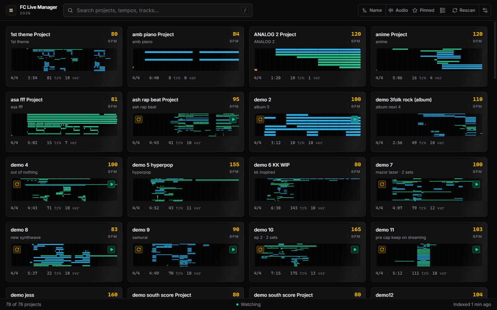

# Setlist

A self-managing library for Ableton Live projects. It reads your `.als` files
directly, so you can browse **tempo, key-signature, length, track list and an
arrangement map for every project** - and play a light preview of each one -
without opening Live and waiting for a 45 MB set to load.

## Install

Grab the installer for your machine from **[Releases](https://github.com/Utsav-GC/fc-live-manager/releases)**:

- **Windows** - `FC-Live-Manager-<version>-win-x64.exe`. A normal setup wizard.
  Windows SmartScreen may warn because the build isn't code-signed:
  *More info → Run anyway*.
- **macOS** - `FC-Live-Manager-<version>-mac-arm64.dmg` (Apple silicon) or
  `-mac-x64.dmg` (Intel). Drag it to Applications; the first time,
  right-click the app → **Open** (unsigned build).

Or run it from source:

```powershell
npm install
npm run build:ui
npm start
```

**New here? [docs/GUIDE.md](docs/GUIDE.md) is a picture-by-picture tour of the
whole app.**



## Why it's fast

The cost in Live isn't the project file, it's *loading* it. Setlist never asks
Live to do anything. It:

1. **Reads the `.als` directly.** An `.als` is gzipped XML (one of yours
   decompresses to 118 MB), so there is a fast, targeted scanner rather than a
   DOM parse: **~0.5 s per project**.
2. **Caches everything to one JSON file** and re-reads only sets whose mtime
   changed.
3. **Draws previews from data it already has** - the arrangement map is built
   from clip positions inside the file, so it costs nothing.
4. **Plays preview audio from disk** over a range-aware local protocol, so seeking
   is instant and nothing is copied.

Time to index 78 projects from cold: **~9 s**. After that, startup is instant.

## What it shows

| | |
|---|---|
| **Tempo** | the set's manual tempo |
| **Time signature** | e.g. `4/4` |
| **Length** | derived from the last arrangement clip |
| **Tracks** | count + full list, typed audio / MIDI / group / return |
| **Arrangement map** | a per-track minimap of clip spans - the "low quality preview" |
| **Versions** | how many saves live in `Backup/`, and when each one happened |
| **Locators** | with bar numbers |
| **Preview audio** | waveform + player for any preview found - dropped on a card, added with Add audio, or matched on disk |

## Where previews come from

Setlist looks, in order, for audio to use as a preview:

1. `<project>/Renders/`, `<project>/Export(s)/`
2. the project folder itself
3. `Documents\Setlist Captures\` - the app's own preview folder
4. the usual export locations - `Desktop`, `Downloads`, `Music`, `Documents` -
   searched at their root only, and **only** for files whose name matches the
   set or the project folder. A stray file there is never guessed at.

Files under `Samples/` are source material and are never used as a preview.

### Adding audio by hand

Audio gets in by hand:

- **drag an MP3 or WAV onto a project's card** (grid view), or
- open the project and click **Add audio** (or **Replace**) beside the player -
  or drag the file straight onto the player.

Either way the app keeps one small listening copy per song - `<Set Name>.mp3`
in `Documents\Setlist Captures` (a WAV is converted to a ~320 kbps MP3 first) -
and leaves your original file exactly where it was. There is never a pile-up:
a newer file replaces the previous listening copy, and **Remove** only takes
the audio off the project - the file stays on disk, and adding a new file
brings it right back.

### Is the preview definitely *that* song?

Not always - and the app says so instead of pretending. A preview is labelled
as verified when its file name matches the set name (`Ash Rap Beat_95BPM_D#minor
Key Master File.wav` for the set `ash rap beat.als`) **or** the project folder
name (`demo 10.wav` for the folder `demo 10`, whose set inside is called
`ep 2`). A file added by hand is filed under the set's own name, so it is
verified too. Anything else found inside the project - a slowed edit, a promo
cut, a loose file someone dropped in - is shown with an amber badge and a note
naming the exact file, because Setlist has no way to prove which song it is.

If several projects share a name (three sets literally called `Untitled`), one
file can't preview all of them: it goes to the project that was saved closest in
time to the export, and the app says so rather than implying certainty.

Diagnostics back up every number the app shows:

```powershell
npm run verify -- "ash rap"   # print the raw bytes behind every value for a project
npm run verify -- --all       # every set: 78 sets, 624 values compared against the raw XML
npm run test:matching         # preview-matching rules (guards against false positives)
npm run test:previews         # add-a-file imports: WAV → 320 kbps MP3, scan picks it up, stale flag
npm run test:drop             # drag-and-drop imports: WAV/MP3/format edge cases
npm run check:renders         # is each preview file referenced by its .als (i.e. source, not a bounce)?
npm run check:lengths         # .als-derived length vs the decoded duration of the preview
```

`docs/PROVENANCE.md` explains, in plain language, where every displayed value
comes from and what is calculated rather than copied - written to be handed to
someone who wants to check the app's honesty without reading the code.

## Running it

```powershell
npm install
npm start
```

On first run Setlist indexes `Desktop`, `Documents\Ableton` and `Music`. Add or
remove folders with **⚙**. The file watcher re-indexes on its own when a set is
saved or a render appears.

```powershell
npm run index        # headless: index and print a table of every project
npm run index -- D:\Music   # index a specific folder
```

`npm run index` is handy for checking the parser without the UI, and it prints
any `.als` that failed to parse.

## Layout

```
src/main/
  als.js        .als parser (gzip + targeted scans) - the core
  library.js    project discovery, caching, preview selection
  peaks.js      PCM WAV/AIFF → waveform peaks, cached by mtime
  previews.js   dropped/added files → MP3 listening copies
  store.js      one-file JSON persistence
  watcher.js    debounced chokidar watcher
  main.js       Electron shell, IPC, range-aware media protocol
src/preload/    contextBridge API (no node access in the renderer)
src/renderer/   UI - React + Tailwind + shadcn components.
                index.html loads the built bundle; `npm run build:ui`
                compiles src/renderer/src → src/renderer/dist (Vite,
                single IIFE so Electron can load it over file://).
scripts/        index-cli, verify-set, selftest, test-*
```

## Notes on the `.als` format

These took probing to establish and are worth writing down:

- The file is **gzip**, magic `1f8b`.
- `<Tempo><Manual Value="…"/>` appears **once**, inside `<MainTrack>` at the
  very end of the document - so tempo requires a full scan, not a header read.
- Tempo is a float with representation noise (`84.0000839`) - it needs rounding.
- `<TimeSignature><Manual Value="201"/>` is an **index into a lookup table**,
  not a signature. The real one is the first `<RemoteableTimeSignature>`
  (`<Numerator>`/`<Denominator>`).
- A track's name is a `<Name>` *block* (`<EffectiveName>` + `<UserName>`), not an
  attribute. Live displays `UserName` when set, otherwise `EffectiveName`
  (Live 12 auto-names tracks `1-MIDI`, `2-Audio`, …).
- Arrangement clips live under `<ArrangerAutomation>`; `<CurrentEnd>` values
  elsewhere belong to session slots and must not count toward song length.
- In a track's body the **Session slots come first and the arrangement section
  comes later**: everything before the first `<ArrangerAutomation>` marker is a
  Session clip. The structure map draws only what follows that marker, because
  it is a picture of the arrangement (measured: 45 of 78 projects here use
  Session clips at all; none is Session-dominant).
- There is **no global musical key**. Live 12 stores a scale per MIDI clip and
  nearly every clip defaults to C, so Setlist does not invent a key. (In practice
  you name your tracks with the key - `Am/c`, `A#m/C#` - which search indexes.)

## Limitations

- Length is the end of the last arrangement clip, so a stray clip far to the
  right inflates it.
- The structure map is the **Arrangement view only**. Session clips are not
  drawn (and don't feed Length), so a set built to be played from Session view
  would show a nearly empty map. It also stops at 28 tracks and 120 clips per
  track, drawn in file order.
- Waveforms are generated for PCM (WAV/AIFF) in the main process; other
  formats (MP3, M4A) are decoded by the player itself, so they get a waveform
  too - just computed on first open instead of cached.
- Previews are **matched by name or added by hand** - the app never renders a
  set itself, so a preview can be an older bounce of the project; the amber ⟳
  marker says so when the set was saved after its audio was made. A file you
  add by hand becomes one small MP3 listening copy per song, so what stays on
  disk stays tiny.
