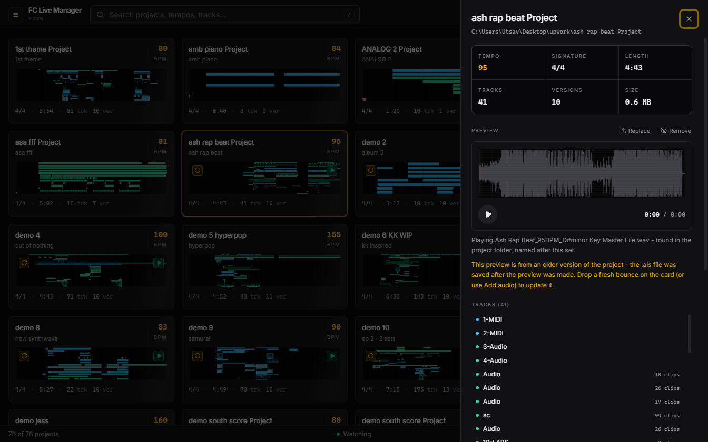
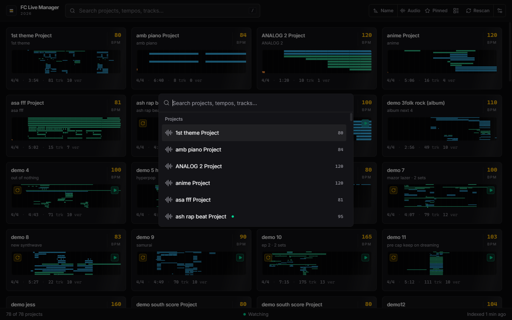
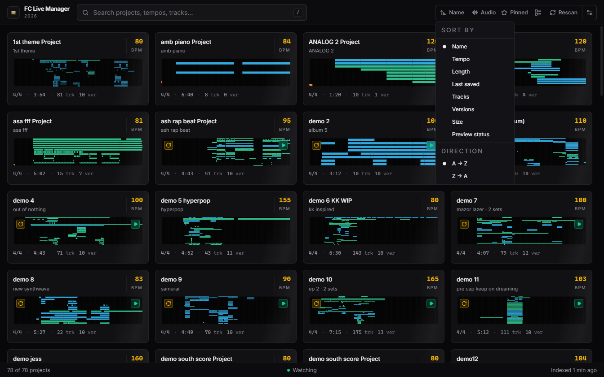
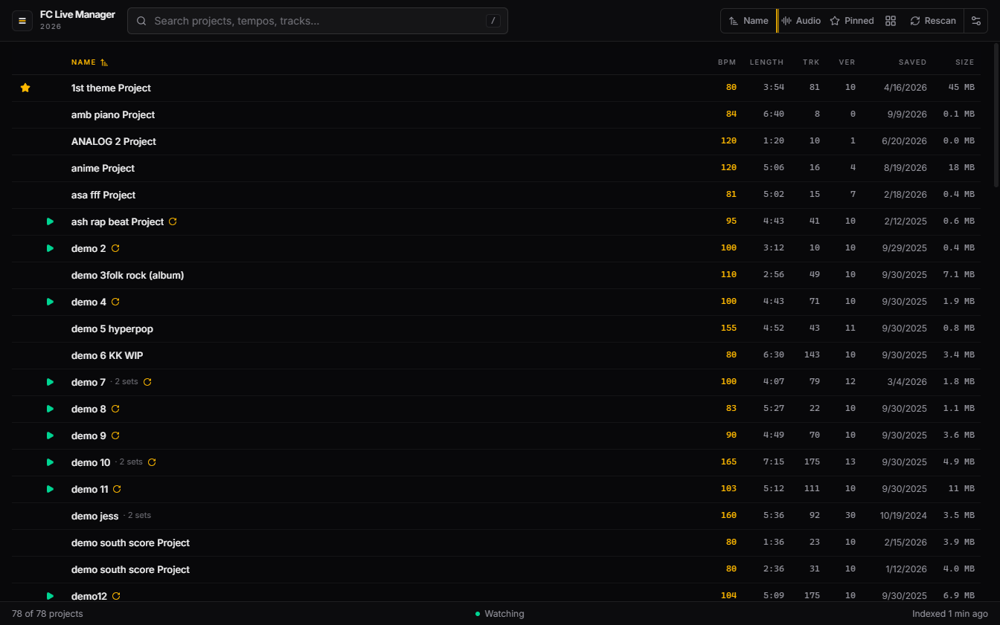
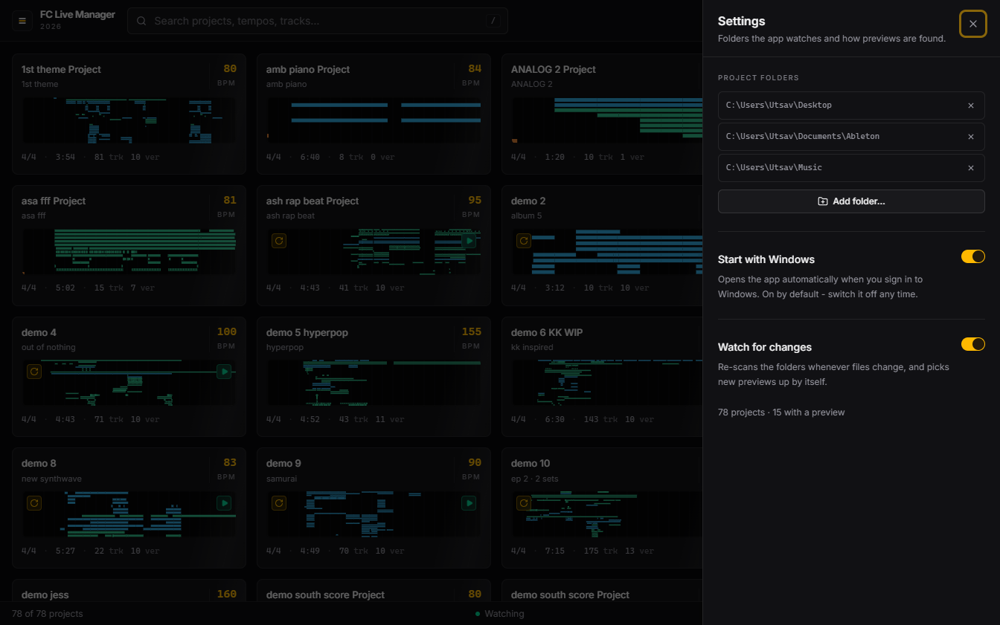

# How to use Setlist - a picture guide

Every screenshot below is the real app (captured from the running window).

Setlist is a library for your Ableton Live projects. It reads your `.als` files
directly - **it never opens Live** - so you can browse tempo, length, tracks and
an arrangement map for every project, and play one light preview per song in a
second or two.

---

## 1. First launch - it finds your projects by itself

On first start, Setlist scans `Desktop`, `Documents\Ableton` and `Music` (you
can add more folders later in Settings). The first index of ~80 projects takes
about 9 seconds; every startup after that is instant, because it only re-reads
projects whose files changed.

The status bar tells you what it's doing:

- **● Watching** - the app is live-watching your folders; new saves and new audio
  show up by themselves.
- **78 of 78 projects · Indexed 1 min ago** - what the library contains and when
  it was last refreshed.

---

## 2. The library - one card per project

Each card is a whole project at a glance:

| On the card | What it means |
|---|---|
| **anime Project** | the project folder's name (and the set name inside, if different) |
| **120 BPM** | the tempo, copied from the `.als` |
| the blue/green drawing | the arrangement map - where clips actually sit in the song |
| **4/4 · 5:06 · 16 trk · 4 ver** | signature · length · tracks · saved versions in `Backup/` |
| amber **▶** badge (top-left) | this project has preview audio - click it to play |
| amber **⟳** badge (top-left) | the audio is older than the last save (see §4) |

**One song plays at a time** - starting another pauses the first. Click the ▶
badge to play/pause, or focus a card and press **Space**.

---

## 3. Add audio to a project (any MP3 or WAV)

There are three ways, all equivalent:

1. **Drag a file onto a card** - from Explorer/Finder, straight onto the project
   it belongs to.
2. **Open the project → Add audio** (see §5) - a normal file picker.
3. **Drag the file onto the player itself** inside the open project.

What happens when you do:

- The app keeps **one small listening copy per song** - `<Song>.mp3`, converted
  to ~320 kbps if your file was a WAV - in `Documents\Setlist Captures`.
- **Your original file is never moved, renamed or deleted.**
- Adding a newer file simply replaces the previous listening copy - no pile-up,
  no duplicates.
- **Remove** takes the audio off the project but *doesn't delete anything* -
  add a new file and the preview comes right back.

Setlist also notices audio that already sits near a project (its folder,
`Renders/`, `Exports/`, or a matching name in `Desktop`/`Downloads`/`Music`/
`Documents`). See [../README.md](../README.md) for the exact matching rules.

---

## 4. The amber ⟳ - "this preview is older than the project"

If the `.als` was saved *after* its audio was made, the card shows an amber ⟳
and the detail pane explains it in plain words. It means: this is an older
bounce - drop a fresh one to update it. The app never pretends an old file is
current.

---

## 5. The project page

Click any card and the project opens on the right:

- **Key facts** - tempo, signature, length, tracks, versions, file size.
- **Preview** - waveform, play button, and where the audio came from in plain
  words ("…found in the project folder, named after this set"). Buttons:
  **Replace** (pick a different file) and **Remove**.
- **Tracks** - every track with its clip count.
- **Versions** - every save in `Backup/`, newest first.

---

## 6. Find things fast

- **Search bar** - press **`/`** from anywhere and type: project name, tempo,
  key, or track name.
- **Command palette** - **Ctrl+K**: jump to any project or run actions (add a
  folder, rescan, open the captures folder).

## 7. Sort it your way

The sort button offers **Name, Tempo, Length, Last saved, Tracks, Versions,
Size, Preview status** and a direction toggle - plus a **Pinned** filter in the
top bar for your favorites.

Prefer tables? The view toggle switches between **grid** and **list** - the
list is every number in one row, with play and pin on each line.

## 8. Settings

Open Settings from the menu (top-left **☰**):

- **Project folders** - where Setlist looks for projects. Add any folder.
- **Start with Windows** - opens the app automatically when you sign in to
  Windows. It's on by default; switch it off any time.
- **Watch for changes** - re-scan whenever files change (recommended on).

## 9. Keyboard

| Key | Action |
|---|---|
| `Space` | play / pause the focused project |
| `Enter` | open the focused project |
| `/` | jump to the search bar |
| `Ctrl+K` | command palette |
| `Esc` | close the panel / palette |

## 10. Where things live on disk

| What | Where |
|---|---|
| Your projects | wherever they already are - the app only reads them |
| Listening copies (one MP3 per song) | `Documents\Setlist Captures` |
| The app's own index + waveform cache | `%APPDATA%\FC Live Manager 2026` |

Setlist never writes inside your project folders, never uploads anything, and
has no telemetry. Every number it shows is labeled with how it was obtained -
the full contract is in [PROVENANCE.md](PROVENANCE.md).
